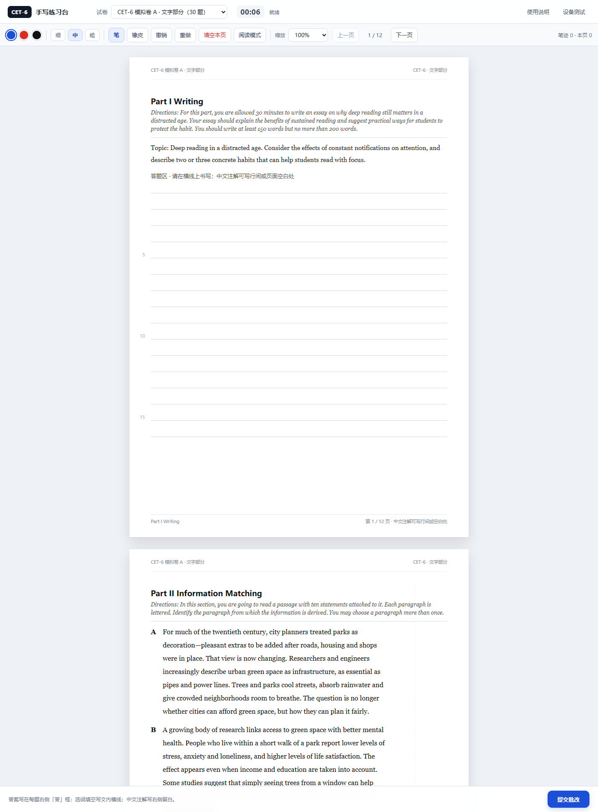
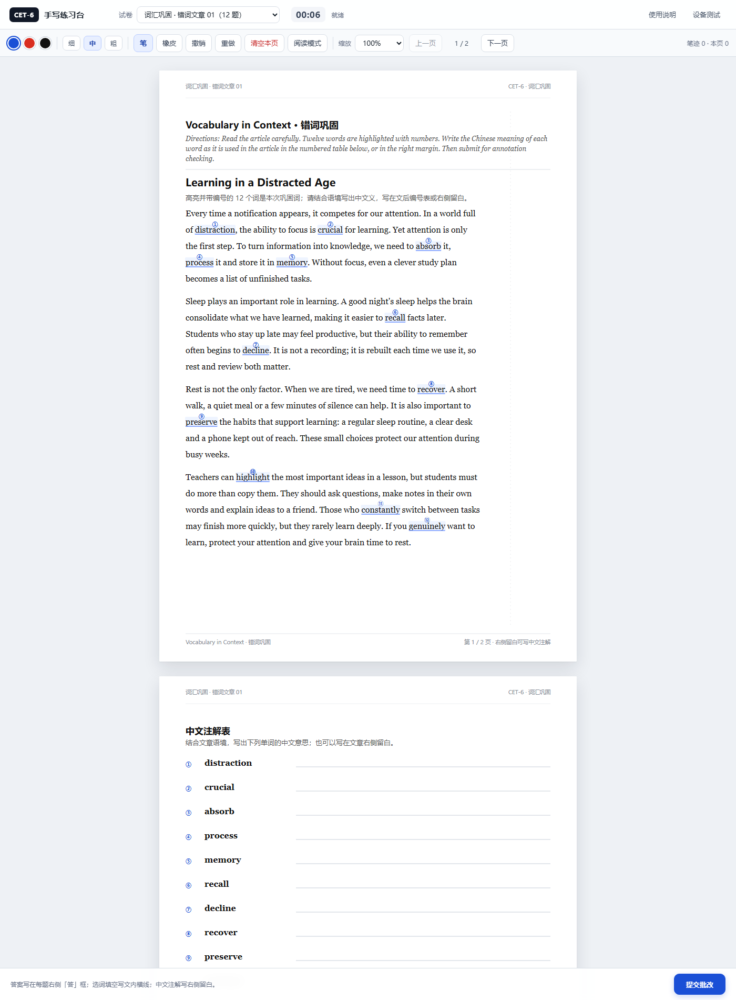
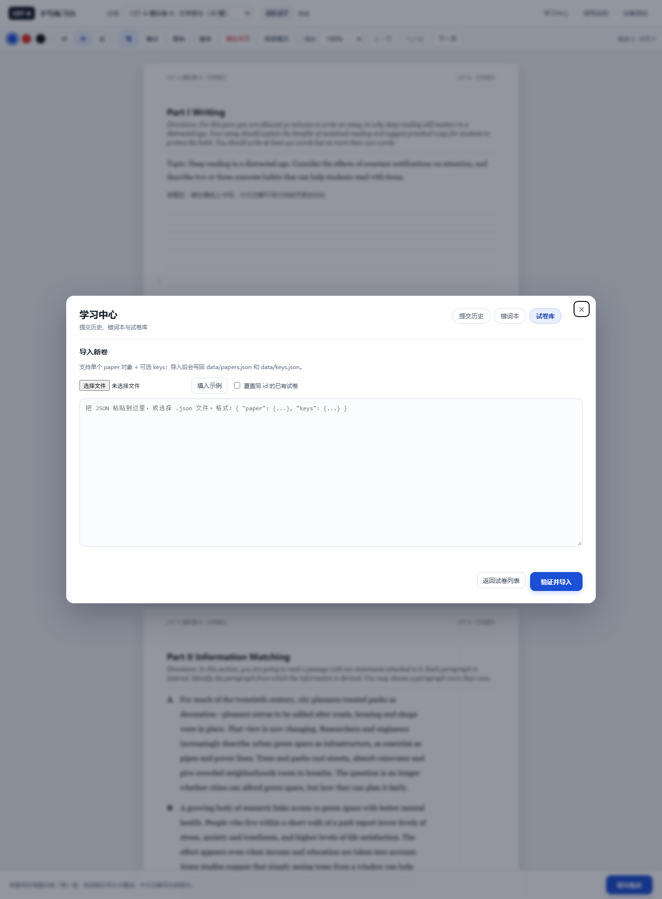

# CET-6 手写练习台

**Local-first CET-6 handwriting practice.** A browser worksheet plus a zero-dependency Node server. Write with a pen tablet, submit page images, and let a local multimodal AI agent review your answers and Chinese annotations. No database, no cloud, no API key required by the app.

本机优先的六级手写练习台：浏览器里显示 A4 文字卷，手绘板直接写，提交后由本地 AI agent 读取页面截图和答案键来批改。数据全部保存在本机。

- 试卷显示：A4 排版，文字清晰，右侧留白专门写中文注解。
- 手写：支持手绘板/触控笔，压感控制笔宽；橡皮、撤销/重做、清空、阅读模式、缩放、自动保存。
- 提交：每页合成 2x PNG，保存到 `submissions/`，并给你一条 `批改 <shortId>` 指令。
- 学习中心：页面内查看提交历史、渲染批改报告、汇总错词本、管理/导入试卷。
- 词汇巩固：把易错词放进一篇短文，你写中文词义，再由 AI 逐词检查；见下文的“错词文章”。
- 隐私：所有文件都在本机项目目录下，不上传外部服务。工作区若在 OneDrive 中，文件会被 OneDrive 同步。

> 当前包含 **CET-6 模拟卷 A · 文字部分**（原创仿真题，不含听力）：写作 1、选词填空 10、信息匹配 10、仔细阅读 10、翻译 1，共 30 道客观题 + 2 道主观题。  
> 另含 **词汇巩固 · 错词文章 01**：把 12 个易错词放进一篇短文，专门练中文注解。

## 截图







## 快速开始

Requirements:

- Node.js **20+**（应用本身零依赖，不需要 `npm install`）
- Chromium-based browser（Edge / Chrome 推荐）
- 可选：Python + Pillow（只有 `tools/crop.py` 裁图工具需要）

1. 启动服务：

   ```bash
   npm start
   ```

   或：

   - Windows：双击 `start.cmd`
   - macOS / Linux：`sh start.sh`（或给可执行位后 `./start.sh`）
   - 服务默认在 `http://127.0.0.1:43110`，并尝试自动打开浏览器；端口被占用时会顺延到 43111–43119，实际地址看启动窗口或 `.port`。

2. 在页面顶部选择试卷，用手绘板直接写。
3. 点右下角 **提交批改**。
4. 把页面显示的指令（例如 `批改 101500-ab12`）发给你本地的多模态 AI agent。
5. AI 读取 `submissions/<id>/`、`data/keys.json` 和 `GRADING.md`，逐题批改并写报告。
6. 打开顶部 **学习中心** 查看历史、渲染报告、错词本和试卷库。

如果服务已经在运行，直接打开 `http://127.0.0.1:43110`。关闭启动窗口即停止服务；数据不会丢。

## 批改是怎么工作的

这个仓库**不包含大模型**。提交后应用只做三件事：合成页面 PNG、保存 `submissions/<id>/`、给你一条 `批改 <shortId>` 指令。

真正的批改由你本地的多模态 AI agent 按 `GRADING.md` 完成：

- 读页面图片和 `layout.json`；
- 对照 `data/keys.json` 判客观题、翻译、写作和中文注解；
- 写 `feedback/<id>.md` / `.json`，并更新 `meta.json`；
- 学习中心读取这些文件并渲染报告。

可以使用 DeepSeek Harness、Claude Code、Cursor 或任何能读本地文件的 agent；不需要 API key 的应用内集成。没有 agent 时，你仍然可以做题、提交、查看页面，或按 `data/keys.json` 自检。

## 学习中心

顶部 **学习中心** 有三个标签，覆盖“看记录、看错词、加新卷”：

### 提交历史 / 批改报告

- 列出所有提交：卷名、shortId、时间、用时、状态（待批改/已批改）、分数。
- 可按“全部 / 当前卷 / 已批改 / 待批改”筛选。
- 点一条提交：
  - 看每页缩略图，点击放大；
  - 已批改的会直接渲染 `feedback/<id>.md` 的完整报告（表格、逐题、注解核对）；
  - 支持“复制报告”和“刷新报告”。
- 适合不想翻文件夹/对话记录，直接回看批改。

### 错词本

- 自动汇总 `feedback/*.json` 里的错词：词、出现次数、错误/部分正确、来源提交、说明。
- 勾选目标词 → **复制生成请求**，把复制的内容发到对话里，我就能按这些词生成新的“错词文章”。
- 下面是“已有错词文章”，可以直接打开继续练。
- 还会列出需要修正的词性/语法笔记。

### 试卷库 / 导入

- 列出 `data/papers.json` 里的所有卷（考试卷/词汇卷、题数、时长），可直接打开。
- **导入新卷**：粘贴 JSON 或选择 `.json` 文件，服务端会验证后写回：
  - `data/papers.json`
  - `data/keys.json`（如果 payload 带 keys）
- 支持勾选“覆盖同 id”；新卷导入后会自动刷新试卷列表并打开。
- 导入格式：`{ "paper": { ... }, "keys": { ... } }`，详见下文的“加更多试卷 / 导入”。
- 直接链接：`?center=history`、`?center=errors`、`?center=library`、`?center=import`，例如 `http://127.0.0.1:43110/?center=errors`。

## 词汇巩固 · 错词文章

“错词文章”是另一类试卷：把最近批改里的易错词编进一篇短文，让你在语境里写中文词义，再由我逐词检查。

当前有 **词汇巩固 · 错词文章 01**（12 个词：distraction、crucial、absorb、process、memory、recall、decline、recover、preserve、highlight、constantly、genuinely）。

用法：

1. 在顶部选 **词汇巩固 · 错词文章 01**，或直接打开：
   `http://127.0.0.1:43110/?paper=vocab-errors-01`
2. 第 1 页读文章：12 个目标词有浅蓝底、下划线和编号（①–⑫）。
3. 第 2 页是“中文注解表”：在每个编号后的横线上写该词**在文章语境中**的中文义；也可以写在文章右侧留白。
4. 提交后，回到对话发送 `批改 <shortId>`；我会逐词判“正确 / 部分正确 / 错误 / 无法辨认”，并指出像 process 这种“名词义对、语境动词义不对”的情况。

以后想生成新的错词文章，对我说“根据最近的批改生成一篇错词文章”即可。我会用 `tools/error-words.mjs` 汇总易错词，再写新文章、加进试卷列表。

## 界面说明

| 区域 | 说明 |
|---|---|
| 顶部 | 选卷、计时、保存状态、学习中心、使用说明、设备测试 |
| 工具栏 | 蓝/红/黑、细/中/粗、笔、橡皮、撤销、重做、清空本页、阅读模式、缩放、上一页/下一页 |
| 试卷 | 每页 A4；右侧虚线右边是中文注解留白 |
| 底部 | 当前笔迹数、「提交批改」 |

### 怎么写

- **选择题/匹配题**：把字母写在每题右侧的「答」框里。
- **选词填空**：把字母写在文内 `______(26)______` 的横线上。
- **翻译/写作**：直接写在横线上，可以写到右侧留白。
- **词汇文章**：在文章第 2 页的编号表横线上写中文词义，或写在文章右侧留白；写“语境义”，不是只写词典第一义。
- **中文注解**：写在页面右侧留白，或写在英文行间。我会结合位置判断你注解的是哪个词。
- 建议蓝色写答案、红色写注解/修改；字尽量写大一点。

### 手写板

- 浏览器通过 Pointer Events 接收手绘板输入；支持压感时线条会随力度变粗/变细。
- 如果线条粗细没有变化，点顶部「设备测试」，看看 `pressure` 是否变化；即使一直是 0.5 也能正常书写。
- 掌托误触：检测到手写笔后，短时间内会忽略触摸输入。

### 自动保存与恢复

- 笔迹会自动保存到浏览器 `localStorage`（按试卷分开）。
- 刷新/崩溃后重新打开，会自动恢复未提交的书写，并提示恢复了几笔。
- 切换试卷会保留当前草稿；提交后草稿仍保留，方便继续修改或重新提交。
- 想从头再来：打开顶部「使用说明」→「清除本卷草稿」；也可以逐页「清空本页」。

### 提交失败怎么办

如果本地服务停了或上传失败，页面会给出兜底：

- **下载全部页面** / **下载当前页**：保存 PNG 到下载目录。
- **复制当前页**：把当前页 PNG 复制到剪贴板，可以直接在 AI 对话里粘贴。
- 然后回到对话说「批改」并说明是哪套卷；AI 仍可以按图片批改（但没有 layout 锚点，定位会粗一些）。

也可以双击 `start.cmd` 重启服务，再点「重试提交」。

## 文件结构

```

cet6-handwriting-practice/
├─ README.md                 # 本文件
├─ GRADING.md                # AI 批改流程、评分口径、报告模板
├─ GITHUB.md                 # 推送到 GitHub 的步骤
├─ LICENSE                   # 代码：MIT
├─ CONTENT-LICENSE.md        # 题库内容：CC BY-NC 4.0
├─ SECURITY.md               # 本地部署/隐私提醒
├─ start.cmd                 # Windows 启动
├─ start.sh                  # macOS/Linux 启动
├─ server.mjs                # 零依赖本地 HTTP 服务
├─ package.json
├─ .gitignore
├─ .gitattributes
├─ .editorconfig
├─ .github/workflows/ci.yml  # 语法 + 数据检查
├─ public/
│  ├─ index.html
│  ├─ styles.css
│  └─ js/                    # 排版、渲染、手写、提交、学习中心
├─ data/
│  ├─ papers.json            # 试卷（不含答案，会通过 HTTP 发给浏览器）
│  └─ keys.json              # 答案键（只读文件，不通过 HTTP 暴露）
├─ submissions/              # 每次提交：meta/layout/page PNG/strokes（gitignore）
├─ feedback/                 # 批改报告：<id>.md / <id>.json（gitignore）
├─ docs/                     # README 截图
├─ tools/
│  ├─ crop.py                # 按锚点裁图，放大看字迹
│  ├─ check.mjs              # 题库/答案键静态检查
│  └─ error-words.mjs        # 从批改报告汇总易错词
├─ tmp/                      # 裁图临时输出（gitignore）
└─ .port                     # 当前服务地址（运行后生成，gitignore）
```

## 加更多试卷

1. 在 `data/papers.json` 的 `papers` 数组里加一套卷。
2. 在 `data/keys.json` 里加同名 key，写 `objective`、`explanations`、`translation`、`writing`。
3. 刷新页面，顶部选卷即可；服务不需要重启。

支持的 block 类型：

| type | 用途 |
|---|---|
| `prompt` | 题目说明/中文翻译原文 |
| `paragraph` | 带字母的匹配段落（`label` + `text`） |
| `passage` | 阅读文章（`text`，空行分段） |
| `wordBank` | 选词填空词库（`items`） |
| `clozePassage` | 带 `[[26]]` 空位的选词短文 |
| `matchingStatements` | 匹配题陈述（`items[].number/text`） |
| `mcq` | 选择题（`items[].number/stem/options`） |
| `answerLines` | 翻译/写作横线（`count`、`label`） |
| `vocabArticle` | 词汇文章（`title`、`note`、`text`、`targets[].number/word`） |
| `vocabTable` | 词汇注解表（`items[].number/word`，每行一条横线） |
| `pageBreak` | 强制从新页开始 |

编号建议按六级：选词 26–35、匹配 36–45、阅读 46–55。每个数字在整卷内唯一。

### 在页面里导入

学习中心 → 试卷库 → 导入新卷。粘贴或选择 `.json`，格式：

```json
{
  "paper": {
    "id": "my-paper-01",
    "title": "我的练习卷 01",
    "kind": "exam",
    "durationMinutes": 30,
    "sections": [
      {
        "id": "reading",
        "heading": "Part I  Reading",
        "instructions": "Directions: ...",
        "blocks": [
          { "type": "passage", "text": "..." },
          {
            "type": "mcq",
            "items": [
              {
                "number": 1,
                "stem": "What is the main idea?",
                "options": ["A) ...", "B) ...", "C) ...", "D) ..."]
              }
            ]
          }
        ]
      }
    ]
  },
  "keys": {
    "paperId": "my-paper-01",
    "objective": { "1": "B" },
    "explanations": { "1": "..." }
  }
}
```

- `keys` 可省略；省略时卷子能显示/提交，但批改没有答案键。
- `id` 只能用小写字母、数字、连字符；同 id 需要勾选“覆盖同 id”。
- 服务端会验证 block 类型、题号唯一性、mcq 的 options、cloze 的 `[[n]]`、vocabTable 的 word 等。
- 导入会写回 `data/papers.json` / `data/keys.json`；刷新页面或直接打开新卷即可。
- 直接链接：`?center=history`、`?center=errors`、`?center=library`、`?center=import`，例如 `http://127.0.0.1:43110/?center=errors`。

### 生成新的错词文章

1. 运行 `node tools/error-words.mjs`，看最近报告里的易错词（也可让我手动汇总）。
2. 选 10–12 个词，写一篇 200–350 词的短文，每个词在语境中出现一次。
3. 在 `data/papers.json` 加一套 `kind: "vocab"` 的卷，用 `vocabArticle` + `pageBreak` + `vocabTable`。
4. 在 `data/keys.json` 加同名 key，写每个词的 `accepted` 义项和语境提醒。
5. 刷新网页即可选到；不需要重启服务。

> 首版是原创仿真题，不是真题。如果你有想练的真题文本/图片，可以发给我，我按同一格式录入；不会主动复制受版权保护的整套真题。

## 隐私与边界

- 全部本地运行：浏览器 ↔ `127.0.0.1` 本地服务 ↔ 项目目录文件；没有外部上传。
- 页面、笔迹、报告都可能包含你的手写内容；工作区在 OneDrive 下时会被同步。
- 不做听力音频、口语、自动 OCR 判卷、官方 CET-6 分数。
- 手写判读是视觉识别，清晰书写可靠；连笔/潦草可能误读，报告会标“字迹不确定”并请你确认。
- 答案键在 `data/keys.json` 里，网页正常界面不显示；不要把它复制到 `public/` 或 `submissions/`。

## 常见问题

**打不开页面？**
先确认启动窗口还在运行；看窗口里打印的地址；或看 `.port`。如果端口被占用，脚本会自动换端口。

**提示找不到 Node？**
安装 Node.js 20+（https://nodejs.org/），确认新开的终端里 `node -v` 能输出版本号。本项目不需要 `npm install`。

**提交后怎么让 AI 批改？**
在对话里发 `批改 <shortId>`。shortId 在提交成功弹窗里，也可以从 `submissions/` 目录名取后 11 位。

**AI 说我某题判错了？**
直接把正确的书写/选项告诉它，它会改判并更新报告。

**想重新做一套？**
换一套卷，或清空当前卷的草稿（见上文）。

**可以公网访问吗？**
本版只绑定 `127.0.0.1`，不对外网开放；避免手写内容暴露。

## 给 AI 的入口

- 批改流程：`GRADING.md`
- 最新提交：`submissions/` 下按修改时间排序
- 答案键：`data/keys.json`
- 裁图：`tools/crop.py`
- 易错词汇总：`tools/error-words.mjs`

用户说「批改」时，先按 `GRADING.md` 找最新未批改提交；不要凭空猜答案。

## License

- **Code**（`server.mjs`、`public/`、`tools/*.mjs`、`start.*`、配置）：[MIT](LICENSE)
- **Original practice content**（`data/papers.json`、`data/keys.json`、原创题目/文章/截图）：[CC BY-NC 4.0](CONTENT-LICENSE.md)
- **User submissions/reports**（`submissions/`、`feedback/`、`tmp/`）不在仓库中，也不受上述内容许可证覆盖。

“CET-6” refers to the College English Test. This project is an independent
practice tool; it is **not affiliated with, endorsed by, or sponsored by** NEEA
or any test provider. If you add real past papers or third-party texts, you are
responsible for the rights to that material.

## 推送到 GitHub

清理好的仓库副本、预检命令、推送/认证/误传处理的详细步骤见 [GITHUB.md](GITHUB.md)。
